# Cust-Post — Project Implementation Todo List & Execution Plan

> **Project Name:** Cust-Post (A space-aware composting assistant for beginners)  
> **Source Documents:** `Cust-Post_PRD_Draft_0.1.docx`, `Cust_Post_Design_Doc_v0_1.docx`, `Cust_Post_Tech_Stack_Documentation.docx`  
> **Architecture & Stack:** Next.js (App Router, TypeScript) + Tailwind CSS + shadcn/ui + Supabase (Auth, PostgreSQL with RLS) + Zod + React Hook Form + Vitest + Playwright.  
> **Core Principle:** Recommend, Explain, Qualify. Zero unverified AI verdicts. Honest uncertainty (unknown remains unknown). Strict distinction between measured and estimated metrics.

---

## Dependency & Sequencing Graph

```mermaid
flowchart TD
    subgraph Phase1["Phase 1: Foundation & Design System"]
        T01["Task 01: Project Setup & Tooling"] --> T02["Task 02: Design Tokens & Base UI Primitives"]
        T02 --> T03["Task 03: Vitest Test Harness Setup"]
    end

    subgraph Phase2["Phase 2: Pure Domain Logic & Rule Engines"]
        T03 --> T04["Task 04: Domain Models & Zod Schemas"]
        T04 --> T05["Task 05: Space & Volume Calculation Engine"]
        T05 --> T06["Task 06: ContainerCheck Suitability Engine"]
        T06 --> T07["Task 07: Method & Mixture Recommendation Engine"]
        T07 --> T08["Task 08: Symptom-Based Troubleshooting Engine"]
        T08 --> T09["Task 09: Readiness Window & Maturity Checker"]
        T09 --> T10["Task 10: Rule Sources & Curated Plant Registry"]
    end

    subgraph Phase3["Phase 3: Database & Auth Infrastructure"]
        T10 --> T11["Task 11: PostgreSQL Schema & SQL Migrations"]
        T11 --> T12["Task 12: Row Level Security Policies & Tests"]
        T12 --> T13["Task 13: Supabase SSR Client & Server Helpers"]
    end

    subgraph Phase4["Phase 4: Frontend Application & Core User Flows"]
        T13 --> T14["Task 14: App Shell, Responsive Navigation & Layout"]
        T14 --> T15["Task 15: Public Editorial Landing Page"]
        T15 --> T16["Task 16: Setup Wizard - Step 1: Space Profile"]
        T16 --> T17["Task 17: Setup Wizard - Step 2: ContainerCheck"]
        T17 --> T18["Task 18: Setup Wizard - Step 3: Waste Inputs Inventory"]
        T18 --> T19["Task 19: Setup Wizard - Steps 4 & 5: Method & Plan Review"]
        T19 --> T20["Task 20: Explainable Recommendation Results Screen"]
        T20 --> T21["Task 21: Batch Initialization & Persistence Layer"]
        T21 --> T22["Task 22: Active Batch Dashboard & Metric Tracking"]
        T22 --> T23["Task 23: Batch Observation Logger & Timeline"]
        T23 --> T24["Task 24: Interactive Troubleshooter Flow"]
        T24 --> T25["Task 25: Physical Maturity Checklist & Batch Closeout"]
        T25 --> T26["Task 26: Plant Guide & Safe Compost Application Hub"]
        T26 --> T27["Task 27: Rule Provenance & User Feedback Mechanism"]
        T27 --> T28["Task 28: User Privacy, Auth & Data Deletion Flow"]
    end

    subgraph Phase5["Phase 5: Verification & Production Release"]
        T28 --> T29["Task 29: End-to-End User Journey Tests"]
        T29 --> T30["Task 30: WCAG 2.2 AA Accessibility & Mobile Audit"]
        T30 --> T31["Task 31: Vercel & Supabase Cloud Deployment"]
    end
```

---

## Phase 1: Foundation, Tooling & Design System

### Task 01: Project Setup & Tooling Configuration
- [x] **Task 01 Overview**: Initialize Next.js 15+ App Router application with TypeScript, ESLint, Prettier, and path aliases.
  - **Files**:
    - Create: `package.json`, `tsconfig.json`, `next.config.ts`, `.eslintrc.json`, `.prettierrc`, `.env.example`, `.gitignore`
  - **Interfaces**:
    - Consumes: None (root baseline).
    - Produces: Runnable Next.js dev server, strict TypeScript compilation, formatting scripts.
  - [x] **Step 1.1**: Initialize Next.js project with App Router, TypeScript, and Tailwind CSS.
  - [x] **Step 1.2**: Configure strict TypeScript paths in `tsconfig.json` (`@/*` pointing to `./src/*`).
  - [x] **Step 1.3**: Configure ESLint and Prettier rules to enforce clean code and formatting.
  - [x] **Step 1.4**: Define environment variable definitions in `.env.example` (`NEXT_PUBLIC_SUPABASE_URL`, `NEXT_PUBLIC_SUPABASE_ANON_KEY`, `SUPABASE_SERVICE_ROLE_KEY`).
  - **Verification**: `npm run build` succeeds with zero TypeScript or linting errors.

---

### Task 02: Design Tokens & Base UI Component Primitives
- [x] **Task 02 Overview**: Implement the Cust-Post botanical editorial visual system tokens (Tailwind CSS) and base accessible components via shadcn/ui.
  - **Files**:
    - Create/Modify: `tailwind.config.ts`, `src/app/globals.css`, `src/components/ui/button.tsx`, `src/components/ui/input.tsx`, `src/components/ui/card.tsx`, `src/components/ui/stepper.tsx`, `src/components/ui/status-chip.tsx`, `src/components/ui/drawer.tsx`
  - **Interfaces**:
    - Consumes: Tailwind CSS config from Task 01.
    - Produces: Brand tokens (`--color-brand: #009775`, `--color-action: #00664F`, `--color-accent: #F6B73E`, `--color-canvas: #F8F3E9`, `--color-surface: #FFFDF8`, `--color-mint: #E4F0E8`, `--color-ink: #17372E`, `--color-text: #34483F`, `--color-muted: #5E6F65`, `--color-border: #D7E1D8`, `--color-warning: #8B4A11`, `--color-error: #A12A24`), custom typography scale (Manrope display font, Inter/DM Sans body), and reusable primitives.
  - [x] **Step 2.1**: Map CSS custom properties into `src/app/globals.css` and extend `tailwind.config.ts`.
  - [x] **Step 2.2**: Implement `Button` with variants: primary action (`#00664F`), secondary paper outline, and icon support (Lucide React).
  - [x] **Step 2.3**: Implement `Input` and `NumberInput` with explicit unit badges (cm, L, kg) and error message slots.
  - [x] **Step 2.4**: Implement `ProgressStepper` (5 discrete steps with accessible non-color-only state indicator).
  - [x] **Step 2.5**: Implement `StatusChip` supporting 4 states: `measured`, `estimated`, `user-reported`, `unknown`.
  - **Verification**: Visual check and Storybook/smoke test confirming all tokens render correctly and meet WCAG contrast thresholds.

---

### Task 03: Vitest Test Harness Setup
- [x] **Task 03 Overview**: Set up Vitest and React Testing Library for fast, isolated unit and integration testing of pure rules and UI components.
  - **Files**:
    - Create: `vitest.config.ts`, `tests/setup.ts`, `tests/unit/smoke.test.ts`
  - **Interfaces**:
    - Consumes: Task 01 & Task 02 setup.
    - Produces: Automated test runner script (`npm run test:unit`).
  - [x] **Step 3.1**: Install `vitest`, `@testing-library/react`, `jsdom`, `@testing-library/jest-dom`.
  - [x] **Step 3.2**: Configure `vitest.config.ts` with JSDOM environment, alias resolution, and setup files.
  - [x] **Step 3.3**: Write a smoke test in `tests/unit/smoke.test.ts` verifying assertion framework functionality.
  - **Verification**: Run `npm run test:unit`; test passes in < 1 second.

---

## Phase 2: Pure Domain Logic & Rule Engines

### Task 04: Domain Models & Zod Schemas
- [ ] **Task 04 Overview**: Define type-safe TypeScript interfaces and Zod validation schemas for all domain entities matching the PRD and Tech Stack docs.
  - **Files**:
    - Create: `src/lib/validation/space-container.schema.ts`, `src/lib/validation/waste-materials.schema.ts`, `src/lib/validation/batch-observation.schema.ts`, `src/lib/validation/rules.schema.ts`, `src/types/domain.ts`, `tests/unit/schemas.test.ts`
  - **Interfaces**:
    - Consumes: Task 03 test runner.
    - Produces: Validated TypeScript types: `LocationType`, `SpaceDimensions`, `ContainerDimensions`, `ContainerCheckInputs`, `WasteInputItem`, `MethodRecommendation`, `BatchObservation`, `MaturityChecklist`.
  - **Step 4.1**: Define schemas rejecting non-positive numbers for dimensions, requiring explicit units (`cm`, `litres`, `kg`).
  - **Step 4.2**: Enforce enum values for `LocationType` (`indoor`, `balcony`, `terrace`, `garden`).
  - **Step 4.3**: Enforce 4-tier recommendation status: `'suitable'`, `'suitable_with_changes'`, `'unsuitable'`, `'more_info_needed'`.
  - **Step 4.4**: Enforce observation chip status: `'measured'`, `'estimated'`, `'user_reported'`, `'unknown'`.
  - **Step 4.5**: Write unit tests verifying that negative dimensions, unknown materials without flags, and blank mandatory units fail validation with user-friendly errors.
  - **Verification**: `npx vitest run tests/unit/schemas.test.ts` passes.

---

### Task 05: Space & Volume Calculation Engine
- [ ] **Task 05 Overview**: Implement pure functions for geometric container volume calculation and space envelope validation.
  - **Files**:
    - Create: `src/lib/compost-rules/volume-calculator.ts`, `tests/unit/volume-calculator.test.ts`
  - **Interfaces**:
    - Consumes: `ContainerDimensions`, `SpaceDimensions` from Task 04.
    - Produces: `calculateGeometricVolume(dim: ContainerDimensions): { volumeLitres: number; isApproximate: boolean; label: string }`, `validateSpaceFit(space: SpaceDimensions, container: ContainerDimensions): { fits: boolean; clearanceCm: { length: number; width: number; height: number } }`.
  - **Step 5.1**: Write failing unit tests for rectangular box ($L \times W \times H \div 1000 = \text{litres}$), cylindrical containers ($\pi r^2 h \div 1000$), and irregular shape handling.
  - **Step 5.2**: Implement calculations with strict rounding (1 decimal place) and explicit disclaimer that geometric volume $\neq$ composting capacity.
  - **Step 5.3**: Implement clearance verification between available space footprint and external container dimensions.
  - **Verification**: `npx vitest run tests/unit/volume-calculator.test.ts` passes all regular and edge cases.

---

### Task 06: ContainerCheck Suitability Engine
- [ ] **Task 06 Overview**: Implement deterministic ContainerCheck logic evaluating material, previous use, ventilation, drainage, lid, and placement.
  - **Files**:
    - Create: `src/lib/compost-rules/container-evaluator.ts`, `tests/unit/container-evaluator.test.ts`
  - **Interfaces**:
    - Consumes: `ContainerCheckInputs` from Task 04.
    - Produces: `evaluateContainer(inputs: ContainerCheckInputs): ContainerEvaluationResult` with fields: `status`, `reasons`, `requiredModifications`, `unresolvedChecks`, `ruleVersion`, `sourceReference`.
  - **Step 6.1**: Write failing unit tests covering critical safety rules:
    - *Safety Guardrail 1*: Prior hazardous chemical storage must immediately return `'unsuitable'` with high-risk warning.
    - *Safety Guardrail 2*: Unknown prior use must return `'more_info_needed'` (never auto-cleared as safe).
    - *Safety Guardrail 3*: Inadequate drainage/aeration must return `'suitable_with_changes'` with specific drill hole guidance.
  - **Step 6.2**: Implement rule engine with transparent condition trees linked to rule IDs (e.g. `RULE-CONT-01`).
  - **Step 6.3**: Verify that plastic/metal containers without known resin/food-grade indicators retain caution flags.
  - **Verification**: `npx vitest run tests/unit/container-evaluator.test.ts` passes with 100% branch coverage on safety guardrails.

---

### Task 07: Method & Mixture Recommendation Engine
- [ ] **Task 07 Overview**: Implement rule-based composting method planner (Aerobic Bin Composting, Vermicomposting, Bokashi) and brown/green waste balance checker.
  - **Files**:
    - Create: `src/lib/compost-rules/method-recommender.ts`, `src/lib/compost-rules/mixture-evaluator.ts`, `tests/unit/method-recommender.test.ts`
  - **Interfaces**:
    - Consumes: Outputs from Task 05 & Task 06.
    - Produces: `recommendCompostingMethod(space, containerEval, wasteInputs, maintenanceWillingness): MethodPlanResult`, `evaluateStartingMixture(materials: WasteInputItem[]): MixtureBalanceResult`.
  - **Step 7.1**: Write failing unit tests checking constraints:
    - Indoor with high cooked/dairy scraps $\to$ Bokashi flagged or strict odor controls required.
    - Balcony with raw veggie scraps & 30-50L ventilated bin $\to$ Aerobic small-batch composting.
    - Incompatible materials (meat, plastic, diseased foliage) flagged as excluded materials.
  - **Step 7.2**: Implement deterministic recommendation logic with explicit `rationale`, `limitations`, `startingSequence`, and `excludedItems`.
  - **Step 7.3**: Implement brown/green ratio estimator providing volumetric guidance (e.g., 2:1 dry leaves/cardboard to wet greens) without claiming spurious universal chemical precision.
  - **Verification**: `npx vitest run tests/unit/method-recommender.test.ts` passes.

---

### Task 08: Symptom-Based Troubleshooting Engine
- [ ] **Task 08 Overview**: Build deterministic troubleshooter module mapping user-reported symptoms to verified corrective actions.
  - **Files**:
    - Create: `src/lib/compost-rules/troubleshooter.ts`, `tests/unit/troubleshooter.test.ts`
  - **Interfaces**:
    - Consumes: Domain enums from Task 04.
    - Produces: `troubleshootCompost(symptom: CompostSymptom, context: BatchContext): TroubleshootingResolution`.
  - **Step 8.1**: Write unit tests for PRD symptom cases:
    - Rot/ammonia odor $\to$ check drainage, add dry browns, aerate, verify moisture.
    - Excess standing water $\to$ check bottom drainage holes, elevate bin, add absorbent brown bedding.
    - Fruit flies / maggots $\to$ cover food scraps with 5cm brown layer, verify tight lid, avoid surface meat/dairy.
    - Dry / slow breakdown $\to$ check moisture (sponge test), add moist green scraps, check ambient temperature.
  - **Step 8.2**: Implement follow-up condition questions where symptom is ambiguous.
  - **Step 8.3**: Attach source IDs (EPA, ADEQ, MCGM handbook) and recommended immediate log action to every resolution.
  - **Verification**: `npx vitest run tests/unit/troubleshooter.test.ts` passes.

---

### Task 09: Readiness Window & Physical Maturity Checklist Evaluator
- [ ] **Task 09 Overview**: Implement readiness estimation and physical maturity verification logic.
  - **Files**:
    - Create: `src/lib/compost-rules/readiness-evaluator.ts`, `tests/unit/readiness-evaluator.test.ts`
  - **Interfaces**:
    - Consumes: Task 04 batch & observation models.
    - Produces: `estimateReadinessWindow(startDate: Date, method: CompostingMethod, totalInputsKg: number): ReadinessEstimate`, `evaluateMaturityChecklist(checks: PhysicalMaturityChecks): MaturityVerdict`.
  - **Step 9.1**: Write tests ensuring no single calendar date is ever returned as a guarantee; output must be a bounded window (e.g. 8–12 weeks).
  - **Step 9.2**: Implement `evaluateMaturityChecklist` requiring 4 observable physical confirmations before compost is declared ready for use:
    1. Dark brown / black crumbly soil-like texture.
    2. Earthy forest smell (no sour/ammonia/rotten odor).
    3. Ambient temperature (pile no longer generates internal heat).
    4. Original food scrap identity completely broken down (except resistant avocado skins/twigs).
  - **Step 9.3**: Implement safety stop: warn against applying immature compost to edible garden plants.
  - **Verification**: `npx vitest run tests/unit/readiness-evaluator.test.ts` passes.

---

### Task 10: Rule Sources & Curated Plant Registry
- [ ] **Task 10 Overview**: Create the static, expert-reviewed data registry for composting rules, citations, and the 3 pilot plant guides.
  - **Files**:
    - Create: `src/lib/data/sources-registry.ts`, `src/lib/data/plant-guides.ts`, `tests/unit/data-registry.test.ts`
  - **Interfaces**:
    - Consumes: Domain schemas from Task 04.
    - Produces: `SOURCES_REGISTRY` mapping rule IDs to citations (EPA Composting Guide, MCGM Citizen's Handbook, ADEQ Troubleshooting Guide), and `PLANT_GUIDES` for 3 starter plants (e.g., Holy Basil/Tulsi, Mint/Pudina, Tomato/Cherry Tomato) with specific compost ratio restrictions.
  - **Step 10.1**: Build `SOURCES_REGISTRY` with title, organization, version, accessed date, and URL.
  - **Step 10.2**: Build `PLANT_GUIDES` defining light needs, pot size, watering, and strict caution that mature compost must be blended (max 20–30% in potting mix) rather than used as 100% soil substitute.
  - **Step 10.3**: Write unit test validating that all referenced rule IDs in Tasks 05–09 exist in `SOURCES_REGISTRY`.
  - **Verification**: `npx vitest run tests/unit/data-registry.test.ts` passes.

---

## Phase 3: Database & Auth Infrastructure

### Task 11: PostgreSQL Schema & SQL Migrations
- [ ] **Task 11 Overview**: Define version-controlled Supabase PostgreSQL relational schema for users, containers, batches, observations, and feedback.
  - **Files**:
    - Create: `supabase/migrations/20261018000001_initial_schema.sql`
  - **Interfaces**:
    - Consumes: Data models from Tasks 04 & 10.
    - Produces: Tables: `profiles`, `containers`, `compost_batches`, `batch_observations`, `recommendation_logs`, `user_feedback`.
  - **Step 11.1**: Define `profiles` table referencing `auth.users(id)` on delete cascade.
  - **Step 11.2**: Define `containers` table with explicit dimension columns (`length_cm`, `width_cm`, `height_cm`, `volume_litres`), enums for shape, prior use, and ventilation.
  - **Step 11.3**: Define `compost_batches` table with foreign key to `containers(id)`, start date, status (`active`, `curing`, `completed`, `abandoned`), and estimated vs measured weight totals.
  - **Step 11.4**: Define `batch_observations` table with foreign key to `compost_batches(id)`, timestamps, nullable temperature, moisture enum, odor enum, pests enum, turning flag, and observation type (`measured`, `estimated`, `user_reported`).
  - **Step 11.5**: Define `user_feedback` table for pilot user reporting on confusing or unhelpful recommendations.
  - **Verification**: Migration applies cleanly in local Supabase or PostgreSQL sandbox without syntax errors.

---

### Task 12: Row Level Security (RLS) Policies & Database Security Tests
- [ ] **Task 12 Overview**: Implement and verify strict PostgreSQL Row Level Security (RLS) on all user data tables to ensure total data isolation between users.
  - **Files**:
    - Create: `supabase/migrations/20261018000002_rls_policies.sql`, `tests/integration/rls-policies.test.ts`
  - **Interfaces**:
    - Consumes: Tables created in Task 11.
    - Produces: Enabled RLS with least-privilege policies using `auth.uid() = owner_id`.
  - **Step 12.1**: Enable RLS on `profiles`, `containers`, `compost_batches`, `batch_observations`, and `user_feedback`.
  - **Step 12.2**: Write policies allowing users to `SELECT`, `INSERT`, `UPDATE`, `DELETE` only rows where `owner_id = auth.uid()`.
  - **Step 12.3**: Allow public `SELECT` on static plant guides and rule sources.
  - **Step 12.4**: Write integration tests asserting that User B cannot read, update, or delete User A's container or batch logs.
  - **Verification**: `npx vitest run tests/integration/rls-policies.test.ts` passes all positive and negative security tests.

---

### Task 13: Supabase SSR Client & Server Helpers
- [ ] **Task 13 Overview**: Configure the official Supabase SSR package (`@supabase/ssr`) for Next.js App Router to handle cookies and server/client authentication securely.
  - **Files**:
    - Create: `src/lib/supabase/client.ts`, `src/lib/supabase/server.ts`, `src/lib/supabase/middleware.ts`, `src/middleware.ts`
  - **Interfaces**:
    - Consumes: Task 01 env vars & Task 12 RLS.
    - Produces: `createClient()` for Client Components, `createServerClient()` for Server Components and Route Handlers, session validation middleware.
  - **Step 13.1**: Implement browser client using `createBrowserClient` with public anon key.
  - **Step 13.2**: Implement server client using `createServerClient` with `cookies()` store from `next/headers`.
  - **Step 13.3**: Implement Next.js `middleware.ts` to refresh expired auth tokens and protect authenticated routes (`/dashboard`, `/batches`) while keeping `/setup` and `/plants` accessible to guests.
  - **Verification**: Smoke test confirms server client retrieves session without throwing cookie errors.

---

## Phase 4: Frontend Application & Core User Flows

### Task 14: App Shell, Responsive Navigation & Layout
- [ ] **Task 14 Overview**: Build the responsive header, navigation bar, footer, and page container applying the warm paper visual theme (`#F8F3E9`).
  - **Files**:
    - Create: `src/components/layout/header.tsx`, `src/components/layout/footer.tsx`, `src/app/layout.tsx`, `src/components/layout/guest-banner.tsx`
  - **Interfaces**:
    - Consumes: Design tokens from Task 02.
    - Produces: Consistent application layout supporting desktop (12-column, 1200px max width) and mobile (single column, minimum 360px viewport).
  - **Step 14.1**: Build `Header` with logo, navigation links (`Plan setup`, `My batch`, `Learn`, `Sources`), and prominent `[Start a setup]` CTA button.
  - **Step 14.2**: Implement responsive hamburger drawer for viewports under 768px with $\ge 44\text{px}$ touch targets.
  - **Step 14.3**: Add non-intrusive `GuestBanner` explaining that setups can be run without an account, with an optional prompt to save progress.
  - **Step 14.4**: Build `Footer` linking to SDG 12 alignment, methodology disclaimers, and feedback form.
  - **Verification**: Check layout across desktop (1440px), tablet (768px), and mobile (360px) viewports with zero horizontal scroll.

---

### Task 15: Public Editorial Landing Page
- [ ] **Task 15 Overview**: Implement the editorial landing page with asymmetric hero, value proposition, and the 3 core feature pillars.
  - **Files**:
    - Create: `src/app/(marketing)/page.tsx`, `src/components/marketing/hero.tsx`, `src/components/marketing/feature-cards.tsx`
  - **Interfaces**:
    - Consumes: Task 14 Layout and Task 02 UI primitives.
    - Produces: Landing page communicating value in $< 10$ seconds without overclaiming AI capabilities.
  - **Step 15.1**: Build `Hero` component featuring Manrope display headline ("Make room for better soil"), concise subtitle, and direct `[Start a setup]` CTA.
  - **Step 15.2**: Build 3 feature cards:
    1. *Space & Container Assessment* (balcony & indoor container screening).
    2. *Real Batch Tracking* (dated observations, moisture, temperature, turnings).
    3. *Evidence-First Troubleshooting* (symptom checks with citations).
  - **Step 15.3**: Add trust/transparency strip highlighting SDG 12 Target 12.5 and explicit commitment to testable, rule-based advice.
  - **Verification**: Landing page renders cleanly and navigates directly to `/setup` on CTA click.

---

### Task 16: Setup Wizard - Step 1: Space Profile Form
- [ ] **Task 16 Overview**: Implement Step 1 of the Setup Wizard capturing available space constraints separate from container dimensions.
  - **Files**:
    - Create: `src/app/(app)/setup/page.tsx`, `src/components/setup/step-space.tsx`, `src/lib/stores/setup-wizard.store.ts`
  - **Interfaces**:
    - Consumes: Task 04 space schema and Task 02 form inputs.
    - Produces: Validated `spaceProfile` saved to client session state.
  - **Step 16.1**: Create `setup-wizard.store.ts` (Zustand or React state) to persist wizard state across steps without losing form data on back navigation.
  - **Step 16.2**: Build location selection tiles: Indoor, Balcony, Terrace, Garden with icons and clear descriptions.
  - **Step 16.3**: Build length, width, and max height input fields in centimeters with real-time numeric validation (positive non-zero numbers).
  - **Step 16.4**: Display progress stepper at Step 1 of 5.
  - **Verification**: Entering 0 or negative numbers shows error message; entering valid dimensions enables "Continue to Container" button.

---

### Task 17: Setup Wizard - Step 2: ContainerCheck & Geometric Volume Form
- [ ] **Task 17 Overview**: Implement Step 2 capturing internal container dimensions, calculating geometric volume, and recording container history.
  - **Files**:
    - Create: `src/components/setup/step-container.tsx`, `src/components/setup/volume-display.tsx`
  - **Interfaces**:
    - Consumes: Task 05 volume calculator & Task 06 container evaluator.
    - Produces: Validated `containerInputs` and calculated geometric volume in litres.
  - **Step 17.1**: Build internal dimension inputs ($L \times W \times H$ in cm) and live `VolumeDisplay` showing geometric volume in litres with explicit label: *"Geometric volume only; does not equal compost capacity"*.
  - **Step 17.2**: Build container questions: material (plastic bucket, terra cotta, wooden crate, metal drum, other), previous contents (food, paint/chemicals, unknown, new), lid status, ventilation holes, and drainage.
  - **Step 17.3**: Ensure "Unknown" options are available and never default to "Safe".
  - **Verification**: User entering container dimensions larger than available space from Step 1 sees an immediate clearance warning.

---

### Task 18: Setup Wizard - Step 3: Waste Inputs Inventory Form
- [ ] **Task 18 Overview**: Implement Step 3 capturing typical organic waste categories and approximate weekly quantities.
  - **Files**:
    - Create: `src/components/setup/step-materials.tsx`, `src/components/setup/material-picker.tsx`
  - **Interfaces**:
    - Consumes: Task 04 waste schema.
    - Produces: Selected materials array with units (`kg/week` or `litres/week`).
  - **Step 18.1**: Build categorized material picker:
    - *Greens*: fruit peels, vegetable scraps, coffee grounds, tea leaves.
    - *Browns*: dry leaves, shredded cardboard/paper, sawdust, coco peat.
    - *Special / Caution items*: cooked food with oils, citrus peels, onion skins.
    - *Excluded items*: meat, bones, pet waste, plastics, diseased plants.
  - **Step 18.2**: Allow quantity input per category with default estimated weekly sliders/inputs.
  - **Step 18.3**: Display immediate inline badge if user selects an item incompatible with household composting without proper prep.
  - **Verification**: Selected items are retained in wizard store; selecting an excluded item displays an informative warning note.

---

### Task 19: Setup Wizard - Steps 4 & 5: Method & Plan Review
- [ ] **Task 19 Overview**: Implement Step 4 (Maintenance willingness & preferences) and Step 5 (Summary review of all inputs before running recommendations).
  - **Files**:
    - Create: `src/components/setup/step-preferences.tsx`, `src/components/setup/step-review.tsx`
  - **Interfaces**:
    - Consumes: Steps 1–3 outputs + Task 07 recommendation engine.
    - Produces: Completed wizard state ready for evaluation.
  - **Step 19.1**: In Step 4, capture user maintenance capacity: daily stirring, weekly turning, or minimal effort; smell sensitivity (high/medium).
  - **Step 19.2**: In Step 5, display a consolidated summary review card with edit shortcuts for Space, Container, and Materials.
  - **Step 19.3**: Add prominent "Generate My Setup Recommendation" action button.
  - **Verification**: Clicking edit on any summary section returns to that step with previously entered values intact.

---

### Task 20: Explainable Recommendation Results Screen & Source Drawer
- [ ] **Task 20 Overview**: Implement the recommendation results view displaying one of the 4 explicit statuses, detailed rationale, required actions, and source citations.
  - **Files**:
    - Create: `src/app/(app)/setup/result/page.tsx`, `src/components/compost/recommendation-card.tsx`, `src/components/compost/source-drawer.tsx`
  - **Interfaces**:
    - Consumes: Task 06 (`evaluateContainer`), Task 07 (`recommendCompostingMethod`), Task 10 (`SOURCES_REGISTRY`).
    - Produces: Interactive result page with 4 distinct states (`suitable`, `suitable_with_changes`, `unsuitable`, `more_info_needed`).
  - **Step 20.1**: Build `RecommendationCard` with clear semantic status badge, headline, and primary reason.
  - **Step 20.2**: Render "Required Setup Modifications" section when status is `suitable_with_changes` (e.g. "Drill 8–10 holes of 6mm diameter in the bottom and sides for drainage and aeration").
  - **Step 20.3**: Render "Unresolved Questions" section when status is `more_info_needed` explaining what must be checked before proceeding.
  - **Step 20.4**: Implement `SourceDrawer` slide-over showing rule ID, reviewer name, organization, and link to source literature.
  - **Verification**: Test rendering for all 4 states; clicking "Why this recommendation?" opens the source drawer displaying verified citation data.

---

### Task 21: Batch Initialization & Persistence Layer
- [ ] **Task 21 Overview**: Implement batch creation allowing users to save their setup and begin tracking an active compost batch (supports local storage for guests and Supabase for authenticated users).
  - **Files**:
    - Create: `src/app/api/batches/route.ts`, `src/lib/services/batch-storage.service.ts`, `src/components/compost/start-batch-modal.tsx`, `tests/integration/batch-api.test.ts`
  - **Interfaces**:
    - Consumes: Validated setup state from Task 20 and Supabase client from Task 13.
    - Produces: New active `CompostBatch` record with generated ID.
  - **Step 21.1**: Build `batch-storage.service.ts` with dual adapters: `LocalStorageAdapter` for anonymous guests and `SupabaseAdapter` for authenticated users.
  - **Step 21.2**: Implement `POST /api/batches` route validating payload with Zod and inserting into `compost_batches` table.
  - **Step 21.3**: Build `StartBatchModal` prompting for Batch Name (e.g., "Balcony Bin #1") and Start Date.
  - **Step 21.4**: If guest, offer optional 1-click email sign-in to sync across devices, or continue locally without blocking.
  - **Verification**: Creating a batch redirects to `/batches/[id]` with batch metadata properly populated.

---

### Task 22: Active Batch Dashboard & Metric Tracking
- [ ] **Task 22 Overview**: Build the active batch overview dashboard displaying batch age, current status, metric indicators, and recent timeline.
  - **Files**:
    - Create: `src/app/(app)/batches/[id]/page.tsx`, `src/components/dashboard/batch-header.tsx`, `src/components/dashboard/metric-summary.tsx`
  - **Interfaces**:
    - Consumes: Task 21 batch record and Task 09 readiness window estimator.
    - Produces: Responsive dashboard screen with distinct measured vs estimated data badges.
  - **Step 22.1**: Build `BatchHeader` showing batch nickname, container volume, method, start date, and status.
  - **Step 22.2**: Build `MetricSummary` showing:
    - Total Organic Input (with explicit badge: `Measured: X kg` or `Estimated: Y kg`).
    - Estimated Readiness Window (e.g., "Between Nov 20 and Dec 15 — pending physical maturity checks").
    - Days Since Last Aeration / Turn.
  - **Step 22.3**: Include prominent quick-action buttons: `[Log Observation]`, `[Troubleshoot Issue]`, `[Maturity Checklist]`.
  - **Verification**: Dashboard renders with zero missing state bugs; metric badges clearly state whether values are measured or estimated.

---

### Task 23: Batch Observation Logger & Timeline
- [ ] **Task 23 Overview**: Implement form for recording dated batch observations and the chronological timeline view.
  - **Files**:
    - Create: `src/components/dashboard/log-observation-modal.tsx`, `src/components/dashboard/batch-timeline.tsx`, `src/app/api/batches/[id]/observations/route.ts`
  - **Interfaces**:
    - Consumes: Task 04 observation schema and Task 22 batch context.
    - Produces: New `BatchObservation` records and chronological activity list.
  - **Step 23.1**: Build `LogObservationModal` with fields:
    - Date & time (defaults to now).
    - Waste addition (optional category + measured weight in grams/kg or estimated volume).
    - Moisture observation chips: `Dry`, `Ideal (damp sponge)`, `Too wet / soggy`.
    - Odour chips: `Earthy / pleasant`, `None`, `Sour / rotten`, `Ammonia`.
    - Temperature field: numeric value $+ ^\circ\text{C}$ or checkbox *"Not measured / No thermometer"*.
    - Turning action: boolean toggle (*"Turned / mixed today"*).
    - Free text observation note.
  - **Step 23.2**: Implement `POST /api/batches/[id]/observations` route with validation.
  - **Step 23.3**: Build `BatchTimeline` rendering reverse-chronological event rows with observation chips.
  - **Verification**: Submitting an observation updates the timeline immediately without page reload.

---

### Task 24: Interactive Troubleshooting Assistant
- [ ] **Task 24 Overview**: Build the guided troubleshooting flow allowing users to report symptoms, answer follow-up checks, and receive cited corrective actions.
  - **Files**:
    - Create: `src/app/(app)/batches/[id]/troubleshoot/page.tsx`, `src/components/troubleshoot/symptom-selector.tsx`, `src/components/troubleshoot/resolution-view.tsx`
  - **Interfaces**:
    - Consumes: Task 08 troubleshooting engine and Task 10 sources registry.
    - Produces: Actionable corrective guidance and optional automatic follow-up log entry.
  - **Step 24.1**: Build `SymptomSelector` presenting clear cards: Odour Issues, Excess Moisture, Too Dry / No Heat, Pests / Flies, Slow Decomposition.
  - **Step 24.2**: Render conditional diagnostic questions (e.g. for odour: *"Does it smell like rotten eggs / ammonia, or vinegar?"*).
  - **Step 24.3**: Build `ResolutionView` separating:
    - *What to Inspect* (e.g. check for clogged drainage holes).
    - *What to Do Immediately* (e.g. add 2 handfuls of dry shredded cardboard and leave lid slightly ajar).
    - *Source Citation* (e.g. EPA Composting at Home Guide, Section 4).
  - **Step 24.4**: Provide 1-click action: `[Apply & Record in Batch Log]`.
  - **Verification**: Selecting "Foul rotten odour" generates actionable brown-addition recommendations with verified source attribution.

---

### Task 25: Physical Maturity Checklist & Batch Completion Flow
- [ ] **Task 25 Overview**: Implement the 4-step observable maturity checklist required before a batch can be marked completed and ready for use.
  - **Files**:
    - Create: `src/app/(app)/batches/[id]/maturity/page.tsx`, `src/components/compost/maturity-checklist.tsx`, `src/components/compost/batch-completion-modal.tsx`
  - **Interfaces**:
    - Consumes: Task 09 readiness evaluator.
    - Produces: Final maturity confirmation and batch status transition to `completed`.
  - **Step 25.1**: Build `MaturityChecklist` presenting 4 mandatory verification questions with photo/description guides:
    1. Color & Texture: Is it dark brown/black with crumbly soil texture?
    2. Odor: Does it smell like fresh forest soil with zero rotting odor?
    3. Temperature: Has the pile cooled to ambient outdoor temperature for $> 1$ week?
    4. Input Breakdown: Are original food scraps unrecognizable?
  - **Step 25.2**: If any check fails, display: *"Compost not ready yet. Keep curing and re-check in 2 weeks"*, with reasons why unready compost can harm plants.
  - **Step 25.3**: If all 4 pass, enable `[Confirm Batch Ready]` and transition status to `completed`.
  - **Verification**: Batch cannot be marked completed unless all 4 physical checks are explicitly confirmed by the user.

---

### Task 26: Plant Guide & Safe Compost Application Hub
- [ ] **Task 26 Overview**: Build the curated plant guide page featuring the 3 starter plants with strict compost usage guidelines.
  - **Files**:
    - Create: `src/app/(app)/plants/page.tsx`, `src/app/(app)/plants/[slug]/page.tsx`, `src/components/plants/plant-card.tsx`
  - **Interfaces**:
    - Consumes: Task 10 `PLANT_GUIDES` dataset.
    - Produces: Browsable plant guide highlighting safe mature compost ratios.
  - **Step 26.1**: Build `/plants` catalog displaying 3 reviewed plant tiles: Tulsi (Holy Basil), Mint (Pudina), and Cherry Tomato.
  - **Step 26.2**: Build `/plants/[slug]` detail view with sunlight, watering, pot size requirements, and seasonal/climate notes.
  - **Step 26.3**: Build "Using Compost with this Plant" section clearly specifying:
    - Maximum blending ratio: 20–30% compost mixed with 70–80% regular soil/coco peat.
    - Explicit warning: Never plant seeds or seedlings directly in 100% pure compost.
  - **Verification**: Plant pages render correctly on mobile and desktop with source citations for plant care advice.

---

### Task 27: Rule Provenance & User Feedback Mechanism
- [ ] **Task 27 Overview**: Implement transparent rule citation browser and user feedback modal allowing pilot testers to flag confusing or unhelpful recommendations.
  - **Files**:
    - Create: `src/app/(app)/sources/page.tsx`, `src/components/feedback/feedback-modal.tsx`, `src/app/api/feedback/route.ts`
  - **Interfaces**:
    - Consumes: Task 10 `SOURCES_REGISTRY` and Task 11 `user_feedback` table.
    - Produces: Public source repository page and feedback collection endpoint.
  - **Step 27.1**: Build `/sources` page listing all literature sources, expert reviewers, and active rule versions.
  - **Step 27.2**: Build `FeedbackModal` accessible from recommendation results and troubleshooter, capturing:
    - Issue type: `Confusing guidance`, `Unsuitable for my space`, `Missing option`, `Incorrect assumption`.
    - Description and user setup context snapshot.
  - **Step 27.3**: Implement `POST /api/feedback` route saving reports for pilot evaluation.
  - **Verification**: Submitting a feedback report saves successfully with confirmation toast.

---

### Task 28: User Privacy, Auth & Data Deletion Flow
- [ ] **Task 28 Overview**: Implement user profile management, authentication modal (magic link / password), privacy summary, and full account/data deletion.
  - **Files**:
    - Create: `src/app/(app)/profile/page.tsx`, `src/components/auth/auth-modal.tsx`, `src/app/api/user/delete/route.ts`
  - **Interfaces**:
    - Consumes: Task 13 Supabase SSR client and Task 11 schema.
    - Produces: Secure auth management and compliance with PRD privacy requirements.
  - **Step 28.1**: Build `AuthModal` supporting passwordless magic link and email/password sign-in.
  - **Step 28.2**: Build `/profile` page displaying account details and transparent data summary (number of containers, batches, and logs stored).
  - **Step 28.3**: Implement `POST /api/user/delete` executing hard cascade deletion of all user records from `containers`, `compost_batches`, `batch_observations`, and `profiles`.
  - **Verification**: Executing deletion wipes all associated user data and terminates session.

---

## Phase 5: Verification, Accessibility & Production Release

### Task 29: End-to-End User Journey Tests
- [ ] **Task 29 Overview**: Implement comprehensive browser-level E2E tests with Playwright validating critical user paths.
  - **Files**:
    - Create: `playwright.config.ts`, `tests/e2e/setup-wizard.spec.ts`, `tests/e2e/batch-tracking.spec.ts`, `tests/e2e/troubleshooter.spec.ts`
  - **Interfaces**:
    - Consumes: Running Next.js application from Tasks 14–28.
    - Produces: Automated E2E verification test suite.
  - **Step 29.1**: Configure Playwright with desktop and mobile viewports.
  - **Step 29.2**: Write test `setup-wizard.spec.ts`: complete 5-step wizard from landing page, receive explainable recommendation, verify all 4 result states.
  - **Step 29.3**: Write test `batch-tracking.spec.ts`: create batch, log 2 dated observations, verify timeline chips.
  - **Step 29.4**: Write test `troubleshooter.spec.ts`: trigger odor symptom, verify resolution and follow-up log creation.
  - **Verification**: `npx playwright test` passes 100% of tests headless.

---

### Task 30: WCAG 2.2 AA Accessibility & Mobile Responsiveness Audit
- [ ] **Task 30 Overview**: Execute automated and manual accessibility audits ensuring keyboard navigability, contrast compliance, and responsive stability.
  - **Files**:
    - Create/Modify: `tests/e2e/accessibility.spec.ts`, styling adjustments across UI components.
  - **Interfaces**:
    - Consumes: Full frontend application.
    - Produces: WCAG 2.2 AA compliant user interface.
  - **Step 30.1**: Run `@axe-core/playwright` accessibility scan on landing page, wizard, result page, and dashboard.
  - **Step 30.2**: Verify visible `:focus-visible` rings on all interactive inputs and buttons.
  - **Step 30.3**: Confirm all status chips and alerts pair color with text labels and semantic icons (no color-alone meaning).
  - **Step 30.4**: Audit mobile touch targets to ensure $\ge 44 \times 44\text{px}$ across 360px viewport width.
  - **Verification**: Zero axe-core accessibility violations reported.

---

### Task 31: Vercel & Supabase Cloud Deployment Configuration
- [ ] **Task 31 Overview**: Configure production deployment on Vercel and Supabase Cloud, verify environment variables, security headers, and pilot readiness.
  - **Files**:
    - Create: `vercel.json`, `README.md`, `docs/PILOT_GUIDE.md`
  - **Interfaces**:
    - Consumes: All completed tasks (Tasks 01–30).
    - Produces: Live, production-ready MVP deployment URL and pilot tester documentation.
  - **Step 31.1**: Set up Vercel project with production environment variables (`NEXT_PUBLIC_SUPABASE_URL`, `NEXT_PUBLIC_SUPABASE_ANON_KEY`, `SUPABASE_SERVICE_ROLE_KEY`).
  - **Step 31.2**: Apply Supabase migrations and enable RLS on production database instance.
  - **Step 31.3**: Configure Content Security Policy (CSP) and HTTP security headers in `next.config.ts`.
  - **Step 31.4**: Compile `docs/PILOT_GUIDE.md` detailing how student pilot testers can run batches, record observations, and report feedback.
  - **Verification**: Production build passes on Vercel; live URL successfully creates a batch and executes recommendation rules.

---

## Safety & Architectural Guardrails Summary Table

| Requirement Area | Guardrail Rule | Enforcing Task |
| :--- | :--- | :--- |
| **Container Safety** | Never declare container safe based solely on resin code or "plastic" label. Unknown history must trigger `'more_info_needed'`. | Task 06, Task 17, Task 20 |
| **Volume vs Capacity** | Dimensions calculate geometric volume only ($L \times W \times H \div 1000$). Explicit disclaimer required. | Task 05, Task 17 |
| **No Artificial Certainty** | Never predict an exact completion date based on dimensions alone. Readiness is a cautious window. | Task 09, Task 22 |
| **Physical Maturity Gate** | Compost cannot be marked ready without user verifying the 4 physical checks (color, smell, temp, breakdown). | Task 09, Task 25 |
| **Rule Provenance** | Every safety-sensitive recommendation and troubleshooting action must display source/reviewer citation. | Task 10, Task 20, Task 24, Task 27 |
| **Transparent Data** | Measured, estimated, and user-reported metrics must carry distinct visual status chips. | Task 02, Task 04, Task 22, Task 23 |
| **Zero Black-Box AI** | Recommendations rely on deterministic, testable rule modules; zero hallucinated safety clearance. | Tasks 06, 07, 08, 09 |
| **Data Privacy** | No mandatory account for initial exploration; no precise geolocation; 1-click full account deletion. | Task 14, Task 21, Task 28 |
